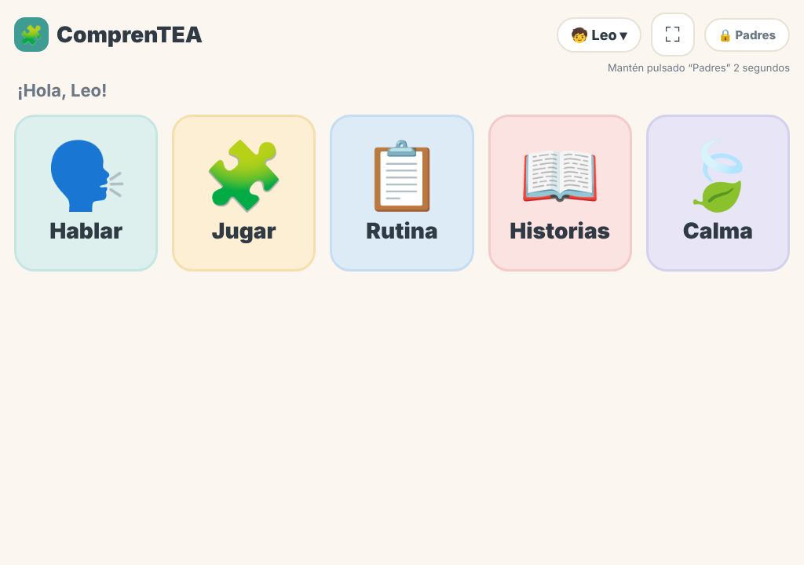
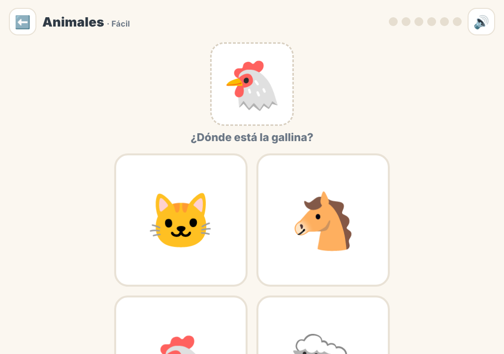
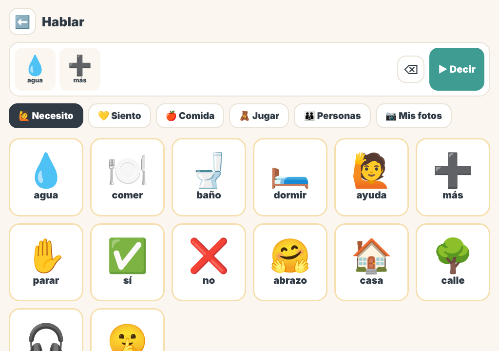
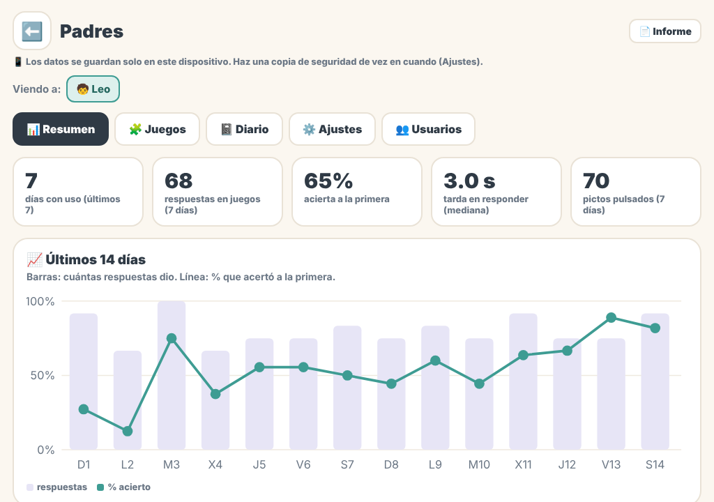

# ComprenTEA

Aplicación web instalable (PWA) de apoyo a la comunicación y la comprensión para niños con TEA (trastorno del espectro autista), pensada sobre todo para niños no verbales, y con un panel para que las familias sigan su evolución.

**👉 Pruébala:** https://samiiamnissar-stack.github.io/comprentea/

<p align="center">
  
  
</p>
<p align="center">
  
  
</p>

## Por qué

Las apps de comunicación aumentativa ayudan al niño a expresarse, pero casi ninguna ayuda a los padres a **entender qué comprende ya su hijo** y cómo avanza. ComprenTEA une las dos cosas: el niño juega y se comunica, y la familia ve datos claros que puede compartir con el logopeda o terapeuta.

## Funcionalidades

### Para el niño
- **Hablar:** tablero de pictogramas por categorías (necesito, siento, comida, jugar, personas) con voz en español y una tira para formar frases cortas. Permite añadir **fotos reales** (familia, objetos propios).
- **Jugar:** 6 juegos de comprensión (colores, animales, números, contar, formas y emociones) con dos modos:
  - 👀 *Buscar igual*: emparejar la imagen (percepción).
  - 👂 *Escuchar*: solo se oye la palabra (comprensión del lenguaje).
- **Dificultad adaptativa:** el número de opciones sube tras 3 aciertos seguidos y baja tras 2 fallos. Además hay 4 niveles (Fácil, Medio, Difícil y Experto). El nivel Experto incluye retos: sumas, sonidos de animales, colores de objetos, formas de colores y situaciones emocionales.
- **Aprendizaje sin error:** al fallar no hay sonidos ni colores de alarma; la opción incorrecta se aclara y la correcta se resalta.
- **Historias sociales** narradas paso a paso (lavarse las manos, si un niño me empuja, separarse de los padres al ir al cole, el ruido, las emociones).
- **Rutina visual** "Ahora / Después" y un **rincón de calma** con respiración guiada.

### Para la familia (área protegida: mantener pulsado 2 s)
- Resumen de uso, % de acierto a la primera, tiempo de respuesta y evolución de 14 días.
- Por juego: lo que **domina**, lo que **está aprendiendo**, lo que le **cuesta** y las **confusiones** más frecuentes.
- **Diario** de observaciones (vídeos que repite, conductas repetitivas, crisis con desencadenante y lo que ayudó, sonidos nuevos…) con detección de **patrones**.
- **Informe** de texto listo para enviar al profesional.
- **Varios usuarios**, cada uno con sus datos, su rutina y su nivel.
- **Copia de seguridad** (exportar/importar en JSON) para pasar los datos a otro dispositivo.

## Decisiones de diseño

- **Baja estimulación sensorial:** paleta suave, colores del juego atenuados por defecto, sin animaciones de pulso ni zoom (activables), volumen bajo y sin sonidos de error.
- **Privacidad:** no hay servidor ni cuentas. Todos los datos se guardan **solo en el dispositivo** (`localStorage`). Ningún dato de menores sale del móvil o la tablet.
- **Funciona sin conexión:** un *service worker* guarda la app en caché tras la primera visita.
- **Sin dependencias:** HTML, CSS y JavaScript sin frameworks; un único archivo de aplicación de menos de 100 KB.

## Tecnologías

| Área | Tecnología |
|---|---|
| Interfaz | HTML5, CSS3 (Grid, variables CSS), JavaScript (ES2020) |
| Instalación y modo sin conexión | Web App Manifest, Service Worker, Cache API |
| Voz | Web Speech API (`speechSynthesis`, voz es-ES) |
| Sonido | Web Audio API (tono suave generado, sin archivos de audio) |
| Datos | `localStorage`, exportación/importación JSON |
| Gráficos | SVG generado en el propio código |
| Publicación | GitHub Pages |

## Instalar en el móvil o la tablet

- **Android (Chrome):** abrir el enlace → menú ⋮ → *Instalar aplicación* o *Añadir a pantalla de inicio*.
- **iPhone / iPad (Safari):** botón Compartir → *Añadir a pantalla de inicio*.
- **PC (Chrome / Edge):** icono de instalar en la barra de direcciones.

## Ejecutar en local

```bash
git clone https://github.com/samiiamnissar-stack/comprentea.git
cd comprentea
python -m http.server 8000
# abrir http://localhost:8000
```

## Estructura

```
index.html              Aplicación completa (interfaz, lógica y estilos)
manifest.webmanifest    Datos de instalación (nombre, iconos, colores)
sw.js                   Service worker: caché y funcionamiento sin conexión
icon-*.png              Iconos de la app
capturas/               Imágenes del README
```

## Próximos pasos

- Pictogramas de [ARASAAC](https://arasaac.org) (licencia CC BY-NC-SA) como alternativa a los emojis.
- Editor de historias sociales con fotos propias.
- Publicación en Google Play como TWA (Trusted Web Activity).

## Aviso

ComprenTEA es una herramienta de apoyo en casa. Sus datos son orientativos y no sustituyen la evaluación de un profesional.
